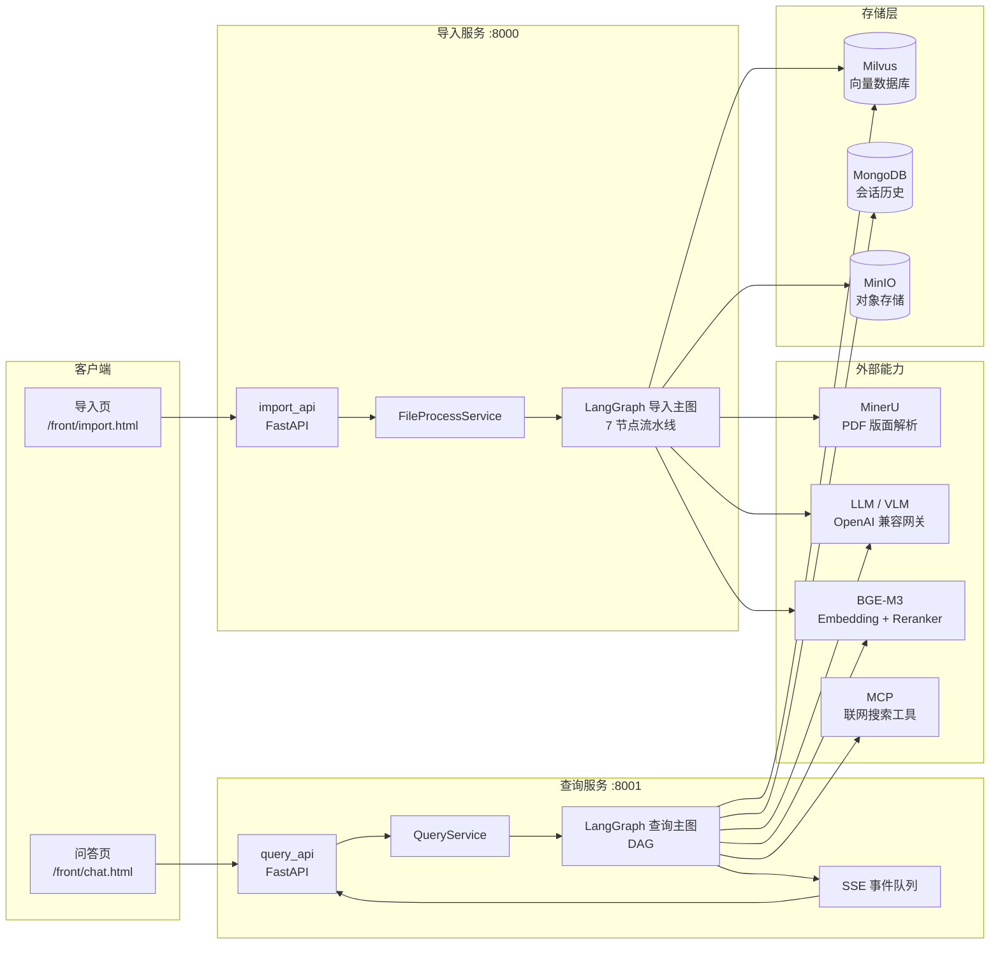
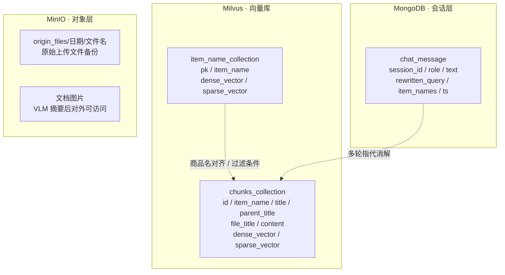
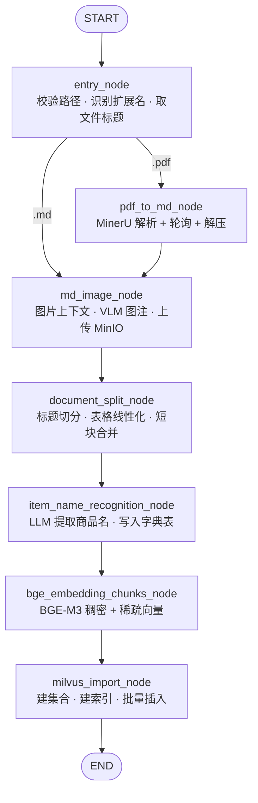
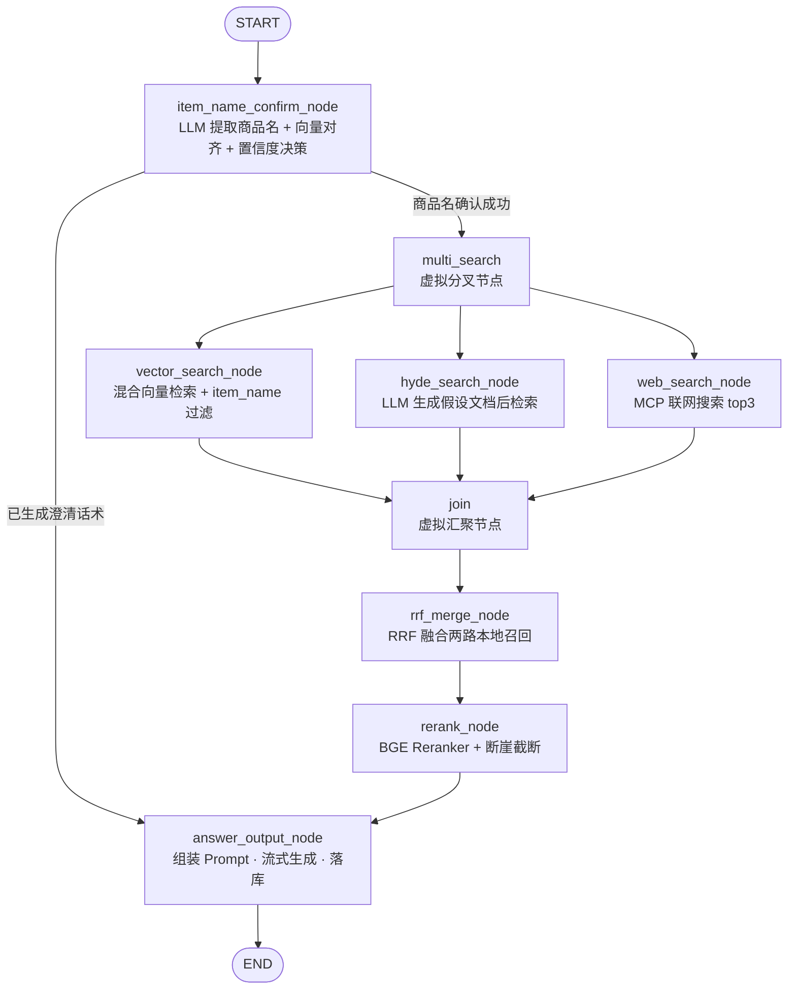

# 掌柜智库 · zhiku-shopkeeper

> 面向企业电子设备手册与维修指南的 **双工作流 RAG 智能问答系统** —— 一条链路把 PDF 手册变成可检索的知识，另一条链路把用户的口语提问变成有据可依的答案。


---

## 📖 目录

- [项目简介](#-项目简介)
- [业务背景](#-业务背景)
- [核心特性](#-核心特性)
- [系统架构](#-系统架构)
- [模块结构](#-模块结构)
- [双工作流详解](#-双工作流详解)
- [快速开始](#-快速开始)
- [API 接口一览](#-api-接口一览)
- [关键配置项说明](#-关键配置项说明)
- [安全说明](#-安全说明)
- [性能与设计亮点](#-性能与设计亮点)
- [Roadmap / 已知限制](#-roadmap--已知限制)
- [License](#-license)

---

## 📖 项目简介

**掌柜智库** 是一个面向企业内部技术文档的检索增强生成（RAG）服务。它把厂商提供的电子设备用户手册、维修指南、配置说明（PDF / Markdown）自动加工成向量知识库，并在用户提问时通过多路召回 + 融合重排 + 大模型生成的方式给出**可溯源**的答案。

整个项目围绕两条独立的 LangGraph 工作流构建：

| 工作流 | 入口 | 职责 |
| --- | --- | --- |
| **导入链路（Import）** | `POST /upload` | PDF → Markdown → 图片理解 → 结构化切分 → 商品名识别 → 向量化 → 入库 |
| **查询链路（Query）** | `POST /query` | 商品名对齐 → 三路并行召回 → RRF 融合 → Rerank 断崖截断 → 流式生成答案 |

两条链路通过 **Milvus** 解耦：导入链路只写，查询链路只读，互不阻塞，可以独立部署、独立扩容。

## 🎯 业务背景

企业 IT 运维与售后服务场景中，设备手册往往具备以下特点：

- **来源分散**：华为、H3C、Aolynk、优利德等不同厂商，格式各异，多为扫描版或排版复杂的 PDF。
- **信息密度不均**：一份 200 页的手册里，真正被高频问到的可能只有十几页（如"怎么测短路""指示灯红灯闪烁是什么意思"）。
- **检索痛点明确**：用户不会说完整型号，只会说"那个万用表怎么调档位""这台网关连不上网"。
- **答案必须可追溯**：维修场景下编造步骤的代价很高，答案必须能指回原手册的具体章节，甚至原图。

传统关键词检索无法处理"型号别名 + 口语化描述 + 图文混排"的组合问题；直接把整本手册塞进大模型上下文又受限于窗口长度与成本。本项目用 **结构化切分 + 双路混合召回 + 重排序截断** 解决上述矛盾。

## ✨ 核心特性

| 特性 | 说明 |
| --- | --- |
| 📄 **PDF 智能解析** | 接入 MinerU 云端解析（`model_version=vlm`），自动完成版面分析、公式/表格/图片抽取，输出带层级标题的 Markdown |
| 🖼️ **图片语义化** | VLM 结合图片上下文（所属标题、上文、下文）生成中文图注，图片上传 MinIO 后回填为可访问 URL，答案中可直接给出示意图 |
| 📊 **表格线性化** | `MarkdownTableLinearizer` 将 HTML/Markdown 复杂表格（含合并单元格、KV 表、交叉表头）转成 LLM 友好的条目化文本，避免表格在向量化后失去语义 |
| 🧩 **层级感知切分** | 按 `#`~`######` 标题切分并维护父子标题链，短块同源合并、长块递归二次切分，切分结果保留 `title` / `parent_title` / `file_title` 三级定位 |
| 🏷️ **商品名自动识别** | LLM 从文档切片中抽取"品牌 + 型号 + 品类"完整商品名，写入独立 Collection，作为查询期强过滤条件 |
| 🔍 **三路并行召回** | 混合向量检索（dense + sparse）+ HyDE 假设文档检索 + MCP 联网检索，三路并行后统一汇聚 |
| ⚖️ **RRF + Rerank 双层精排** | RRF 做无监督排名融合，BGE Reranker 做交叉编码相关性打分，再用**断崖检测**动态决定保留条数 |
| 🌊 **SSE 流式输出** | 基于队列 + 异步生成器实现 `progress` / `delta` / `final` 三类事件，前端可实时看到节点进度与逐字答案 |
| 🔒 **客户端单例** | 双重检查锁（Double-Checked Locking）统一管理 OpenAI / Milvus / MinIO / MongoDB / BGE 客户端，避免并发重复初始化 |
| 🧱 **节点基类模板方法** | `BaseNode.__call__` 统一封装日志、任务追踪、耗时统计、异常包装，子类只需实现 `process()` |
| 🧪 **节点可独立测试** | 每个节点文件带 `__main__` 自测入口，切分/向量化/识别结果均落盘为 `chunks*.json` 便于断点调试 |
| 📈 **任务进度可观测** | `task_util` 维护 running / done / duration / result 四张表，`/status/{task_id}` 直接返回中文节点进度 |

## 🏗️ 系统架构

### 整体架构



### 存储层数据模型



**设计要点**

- `chunks_collection` 同时存放稠密向量（`FLOAT_VECTOR`, COSINE）与稀疏向量（`SPARSE_FLOAT_VECTOR`, IP），检索时用 `WeightedRanker(0.5, 0.5)` 做混合打分。
- `item_name_collection` 是**商品名字典**，导入时写入、查询时用于把用户口语对齐到知识库里的规范名称，再作为 `item_name in [...]` 过滤表达式下推到向量检索。
- MongoDB 只存对话，不存向量；MinIO 承担原文件归档与图片外链，两者都可降级（失败仅告警，不阻断主流程）。

## 🧩 模块结构

```text
zhiku-shopkeeper/
├── README.md
├── .gitignore                      # 忽略 .env / 密钥 / 本地产物 / IDE 文件
├── main.py                         # PyCharm 脚手架示例，非业务入口
└── knowledge/                      # 业务代码根包
    ├── .env.example                # 环境变量模板（占位符版本，可安全提交）
    ├── api/                        # HTTP 接入层
    │   ├── import_api.py           # 导入服务，:8000
    │   └── query_api.py            # 查询服务，:8001
    ├── core/                       # 基础设施
    │   ├── paths.py                # 项目路径解析（temp_data / front）
    │   └── deps.py                 # FastAPI 依赖注入（Service 单例）
    ├── processor/                  # 工作流层
    │   ├── import_processor/       # 导入主图
    │   │   ├── main_graph.py       # StateGraph 组装与条件边
    │   │   ├── base.py             # BaseNode 模板方法 + 彩色日志
    │   │   ├── state.py            # ImportGraphState 定义
    │   │   ├── config.py           # ImportConfig（环境变量驱动）
    │   │   ├── exceptions.py       # 分层异常体系
    │   │   └── nodes/              # 7 个业务节点
    │   └── query_processor/        # 查询主图
    │       ├── main_graph.py       # StateGraph 组装、并行扇出与汇聚
    │       ├── base.py             # BaseNode + SSE 进度推送
    │       ├── state.py            # QueryGraphState 定义
    │       ├── config.py           # QueryConfig（检索/重排/置信度阈值）
    │       ├── exceptions.py       # 分层异常体系
    │       └── nodes/              # 7 个节点实现（图中另含 2 个虚拟编排节点）
    ├── prompts/                    # 提示词模板
    │   ├── import_prompt.py        # 商品名抽取提示词
    │   └── query_prompt.py         # 商品名提取 / HyDE / 答案生成
    ├── schema/                     # Pydantic 请求响应模型
    │   ├── upload_schema.py
    │   └── query_schema.py
    ├── service/                    # 业务编排层
    │   ├── file_process_service.py # 落盘、MinIO 备份、驱动导入图
    │   └── query_service.py        # 驱动查询图、历史读写
    ├── utils/                      # 通用工具
    │   ├── client/
    │   │   ├── base.py             # BaseClientManager 双重检查锁模板
    │   │   ├── ai_clients.py       # OpenAI / VLM / BGE-M3 / Reranker
    │   │   └── storage_clients.py  # MinIO / Milvus / MongoDB
    │   ├── milvus_util.py          # 混合检索请求构建与执行
    │   ├── embedding_util.py       # dense + sparse 向量解析
    │   ├── markdown_util.py        # 表格线性化
    │   ├── mongo_history_util.py   # 会话历史读写
    │   ├── sse_util.py             # SSE 队列与协议打包
    │   └── task_util.py            # 任务状态 / 节点耗时追踪
    ├── front/                      # 内置演示前端
    │   ├── import.html
    │   └── chat.html
    ├── test/                       # 手工验证脚本
    ├── requirements.txt            # 依赖清单
    ├── temp_data/                  # 上传文件与解析中间产物（不入库）
    └── docs/                       # 文档预留目录
```

| 目录 | 职责 |
| --- | --- |
| `knowledge/api` | 仅做参数校验、依赖注入、路由注册与静态资源挂载，不含业务逻辑 |
| `knowledge/core` | 路径解析与依赖注入容器，为上层屏蔽环境差异 |
| `knowledge/processor` | 两个 LangGraph 主图与全部节点实现，是整个系统的核心 |
| `knowledge/prompts` | 所有 LLM 提示词集中管理，便于统一调优与版本对比 |
| `knowledge/schema` | 请求/响应契约，保证接口对外稳定 |
| `knowledge/service` | 串联「HTTP 请求 → 图执行 → 结果落库」的编排层 |
| `knowledge/utils` | 客户端管理、向量检索、SSE、任务追踪等横切能力 |
| `knowledge/front` | 零构建的演示页面，由 FastAPI `StaticFiles` 挂载在 `/front` |

## 🔄 双工作流详解

### 导入链路：7 节点流水线



| # | 节点 | 输入 | 关键动作 | 输出 |
| --- | --- | --- | --- | --- |
| 1 | `entry_node` | `import_file_path`、`file_dir` | 非空校验、存在性校验、扩展名分派（`.pdf` / `.md`）、提取 `file_title` | `is_pdf_read_enabled` / `is_md_read_enabled`、`pdf_path` 或 `md_path` |
| 2 | `pdf_to_md_node` | `pdf_path` | 申请 MinerU 上传链接 → PUT 上传 → 每 3s 轮询（上限 30s）→ 下载 zip → 解压 → `full.md` 重命名为 `<文件名>.md` | `md_path` |
| 3 | `md_image_node` | `md_path` | 扫描 `images/` 目录，按图片在正文中的位置截取上下文，VLM 生成中文图注，上传 MinIO 并替换 Markdown 图片链接 | 备份 `<文件名>_new.md`、`md_content` |
| 4 | `document_split_node` | `md_content`、`file_title` | 按标题正则切块（跳过代码块内标题）、维护 7 级标题栈、表格线性化、超长递归切分、同源短块合并 | `chunks`、`chunks.json` 备份 |
| 5 | `item_name_recognition_node` | `chunks` | 取前 `k` 个切片（长度上限 `item_name_chunk_size`）交 LLM 抽取商品名，`UNKNOWN` 时回退为文件标题；向量化后写入 `item_name_collection` | `item_name`、回填 `chunks[*].item_name` |
| 6 | `bge_embedding_chunks_node` | `chunks` | 按 `embedding_batch_size` 分批，将 `item_name + content` 拼接后生成 dense/sparse 向量 | `chunks[*].dense_vector` / `sparse_vector` |
| 7 | `milvus_import_node` | `chunks` | 丢弃无向量切片，`chunks_collection` 不存在则自动建表建索引（AUTOINDEX + SPARSE_INVERTED_INDEX），插入后回填自增 `chunk_id` | 向量库落库完成 |

> 条件边位于 `entry_node` 之后：`import_router()` 依据 `is_pdf_read_enabled` / `is_md_read_enabled` 决定进入 `pdf_to_md_node` 还是直接跳到 `md_image_node`。

### 查询链路：8 步 DAG



| # | 节点 | 关键动作 | 状态字段 |
| --- | --- | --- | --- |
| 1 | `item_name_confirm_node` | 从 MongoDB 取近 10 条历史 → LLM 抽取 `item_names` 并改写问题 → 向量检索商品名字典 → 按高/中置信度与分差阈值决策 | `item_names`、`rewritten_query`、`history` |
| 2 | `vector_search_node` | 改写后问题向量化，构建 dense + sparse 混合检索请求，附带 `item_name in [...]` 过滤 | `embedding_chunks` |
| 3 | `hyde_search_node` | 让 LLM 以技术文档口吻先写一段 200~300 字"假设答案"，与问题拼接后再检索，缓解短查询语义稀疏 | `hyde_embedding_chunks` |
| 4 | `web_search_node` | 通过 MCP `bailian_web_search` 工具取 3 条网页结果；未配置或调用失败时静默降级为空列表 | `web_search_docs` |
| 5 | `join` | 虚拟汇聚节点（`lambda x: {}`），等待三路全部完成 | — |
| 6 | `rrf_merge_node` | 对两路本地召回做格式归一，按 `weight / (k + rank)` 累加得分，去重后取 top-N | `rrf_chunks` |
| 7 | `rerank_node` | 本地文档与网页文档合并 → 构建 Q-D 对 → CrossEncoder 打分 → `sigmoid` 归一 → 排序 → 断崖截断 | `reranked_docs` |
| 8 | `answer_output_node` | 按字符预算截断参考内容与历史，组装 `ANSWER_PROMPT`；流式走 SSE `delta` + `final`，非流式写入任务结果；最后保存问答历史 | `answer` |

> **关于节点计数**：图中 `multi_search` 是 `lambda x: x` 的**虚拟扇出锚点**（不承载业务逻辑，仅用于让三条并行边从同一节点出发），因此不计入 8 个节点；`join` 承担实际的三路汇聚语义，计入。之所以显式建这两个虚拟节点，是为了让并行分支在图上清晰可读，也便于后续替换成真实的路由逻辑。

**关键分支语义**

- `route_after_item_confirm()` 读取 `state["answer"]`：若商品名无法唯一确认（命中多个中等置信度候选），节点会直接写入澄清话术，图立即短路到 `answer_output_node`，**跳过全部检索**，避免答非所问。
- 三路召回彼此独立，任一失败（尤其是联网检索）都只返回空结果，不影响主链路。

## 🚀 快速开始

### 环境要求

| 组件 | 版本 / 说明 |
| --- | --- |
| Python | 3.12（代码使用了 `TypedDict`、`X \| None` 等现代语法） |
| Milvus | 2.4+（需支持 `hybrid_search` 与稀疏向量索引） |
| MongoDB | 4.0+，用于会话历史 |
| MinIO | 任意兼容 S3 的对象存储，用于原文件与图片 |
| MinerU | 云端 API（`/file-urls/batch`、`/extract-results/batch/{id}`） |
| GPU（可选） | 加载 BGE-M3 与 BGE Reranker 时建议使用；纯 CPU 亦可但速度明显下降 |

### 1. 安装依赖

```bash
# 建议使用独立虚拟环境
conda create -n zhiku python=3.12 -y
conda activate zhiku

cd zhiku-shopkeeper
pip install -r knowledge/requirements.txt
```

`requirements.txt` 覆盖的核心依赖：

```text
langgraph              # 工作流编排
langchain-openai       # ChatOpenAI 客户端
langchain-text-splitters
pymilvus[model]        # Milvus 客户端 + BGE-M3 嵌入
sentence-transformers  # CrossEncoder 重排
minio / pymongo        # 存储客户端
fastapi / uvicorn      # HTTP 服务
openai-agents          # MCP 联网检索
python-dotenv          # 环境变量加载
torch / transformers   # 模型推理底座
```

> `torch` 请按本机 CUDA 版本到官方源选择对应 wheel，直接 `pip install torch` 可能装到 CPU 版本。

### 2. 配置环境变量

仓库提供了带占位符的配置模板 `knowledge/.env.example`，请复制为**项目根目录**下的 `.env` 后再填入真实值（`.env` 已被 `.gitignore` 忽略，切勿提交）：

```bash
# Linux / macOS
cp knowledge/.env.example .env

# Windows PowerShell
Copy-Item knowledge/.env.example .env
```

> `python-dotenv` 的 `load_dotenv()` 默认从**当前工作目录**加载，因此 `.env` 必须放在项目根目录（即启动服务时的工作目录），而不是 `knowledge/` 内部。

最小可用配置骨架（**值为占位符，请替换为你自己的配置**）：

```ini
# ========== LLM / VLM（OpenAI 兼容网关） ==========
OPEN_API_BASE=https://your-llm-gateway.example.com/v1
OPEN_API_KEY=sk-your-key-here
LLM_DEFAULT_MODEL=your-chat-model
VL_MODEL=your-vision-model

# ========== 本地向量模型 ==========
BGE_M3_PATH=/path/to/bge-m3
BGE_RERANKER_LARGE=/path/to/bge-reranker-large
BGE_DEVICE=cuda:0
BGE_FP16=true

# ========== Milvus ==========
MILVUS_URL=http://your-milvus-host:19530
CHUNKS_COLLECTION=zhiku_chunks
ITEM_NAME_COLLECTION=zhiku_item_names

# ========== MongoDB ==========
MONGO_URL=mongodb://your-mongo-host:27017
MONGO_DB_NAME=zhiku

# ========== MinIO ==========
MINIO_ENDPOINT=your-minio-host:9000
MINIO_ACCESS_KEY=your-access-key
MINIO_SECRET_KEY=your-secret-key
MINIO_BUCKET_NAME=zhiku

# ========== MinerU（PDF 解析） ==========
MINERU_BASE_URL=https://your-mineru-endpoint
MINERU_API_TOKEN=your-mineru-token

# ========== MCP 联网检索（可选） ==========
MCP_DASHSCOPE_BASE_URL=https://your-mcp-endpoint
MCP_DASHSCOPE_API_KEY=your-mcp-key
```

### 3. 启动服务

两个服务**必须分别启动**，因为它们挂载的是同一个 `knowledge` 包但监听不同端口：

```bash
# 终端 1：导入服务（:8000）
python -m knowledge.api.import_api

# 终端 2：查询服务（:8001）
python -m knowledge.api.query_api
```

启动后可直接访问内置演示页面：

| 页面 | 地址 |
| --- | --- |
| 文件导入 | `http://127.0.0.1:8000/front/import.html` |
| 智能问答 | `http://127.0.0.1:8001/front/chat.html` |
| 接口文档（Swagger） | `http://127.0.0.1:8000/docs`、`http://127.0.0.1:8001/docs` |

### 4. 跑通第一个问题

```bash
# 1) 上传一份手册，拿到 task_id
curl -X POST http://127.0.0.1:8000/upload \
  -F "file=@./knowledge/processor/import_processor/input_dir/万用表RS-12的使用.pdf"

# 2) 轮询导入进度（返回中文节点列表与各节点耗时）
curl http://127.0.0.1:8000/status/<task_id>

# 3) 非流式提问
curl -X POST http://127.0.0.1:8001/query \
  -H "Content-Type: application/json" \
  -d '{"query":"RS-12 万用表怎么测直流电压？","is_stream":false}'

# 4) 流式提问：先提交拿 task_id，再订阅 SSE
curl -X POST http://127.0.0.1:8001/query \
  -H "Content-Type: application/json" \
  -d '{"query":"RS-12 万用表怎么测直流电压？","is_stream":true}'
curl -N http://127.0.0.1:8001/stream/<task_id>
```

### 5. 单节点调试

每个节点文件末尾都带 `__main__` 自测入口，可脱离 FastAPI 单独验证：

```bash
python -m knowledge.processor.import_processor.nodes.document_split_node
python -m knowledge.processor.query_processor.nodes.rerank_node
```

切分与向量化结果会落盘到 `output_dir/<文件名>/` 下的 `chunks.json`、`chunks_item_name.json`、`chunks_vector.json`，便于逐步排查。

## 📡 API 接口一览

### 导入服务（默认端口 `8000`）

| 方法 | 路径 | 说明 |
| --- | --- | --- |
| `GET` | `/hello` | 健康探针，返回 `hello world` |
| `POST` | `/upload` | 上传 PDF / Markdown 手册，落盘 + MinIO 备份后以 `BackgroundTasks` 异步触发导入图，立即返回 `task_id` |
| `GET` | `/status/{task_id}` | 查询导入任务状态，返回 `status` / `done_list` / `running_list` / `durations` |
| `GET` | `/front/*` | 静态资源，`import.html` 为上传与进度演示页 |

**`POST /upload` 响应示例**

```json
{
  "message": "文件上传成功",
  "task_id": "9f3c1a7e"
}
```

**`GET /status/{task_id}` 响应示例**

```json
{
  "status": "processing",
  "done_list": ["上传文件", "检查文件", "PDF转Markdown", "Markdown图片处理"],
  "running_list": ["文档切分"],
  "durations": {
    "上传文件": 0.42,
    "检查文件": 0.01,
    "PDF转Markdown": 18.63
  }
}
```

### 查询服务（默认端口 `8001`）

| 方法 | 路径 | 说明 |
| --- | --- | --- |
| `GET` | `/hello` | 健康探针 |
| `POST` | `/query` | 核心问答接口。`is_stream=false` 同步返回完整答案；`is_stream=true` 返回 `task_id` 供订阅 SSE |
| `GET` | `/stream/{task_id}` | SSE 长连接，`text/event-stream`，推送 `progress` / `delta` / `final` 三类事件 |
| `GET` | `/history/{session_id}` | 获取会话历史（按时间升序） |
| `DELETE` | `/history/{session_id}` | 清空指定会话的全部历史消息 |
| `GET` | `/front/*` | 静态资源，`chat.html` 为对话演示页 |

**`POST /query` 请求体**

```json
{
  "query": "这台网关的指示灯一直闪红灯是什么意思？",
  "session_id": "可省略，省略时服务端自动生成",
  "is_stream": true
}
```

**非流式响应**

```json
{
  "message": "查询请求已处理完成",
  "session_id": "6b1f...",
  "answer": "红灯闪烁通常表示……",
  "done_list": ["确认问题产品", "切片搜索", "切片搜索(假设性文档)", "网络搜索", "倒排融合", "重排序", "生成答案"]
}
```

**流式响应（SSE）事件格式**

```text
event: progress
data: {"status":"processing","done_list":["确认问题产品"],"running_list":["切片搜索"]}

event: delta
data: {"delta":"红灯闪烁通常表示"}

event: final
data: {}
```

> 客户端断开连接时，`sse_generator` 会通过 `request.is_disconnected()` 主动探测并回收队列，避免内存泄漏。

## ⚙️ 关键配置项说明

所有配置均通过环境变量注入，`ImportConfig` / `QueryConfig` 内部使用 `@dataclass` + `field(default_factory=...)` **懒加载**，缺失时才报错，便于分模块部署。

### 模型与推理

| 变量 | 作用 | 必填 | 说明 |
| --- | --- | --- | --- |
| `OPEN_API_BASE` | LLM/VLM 网关地址 | ✅ | 兼容 OpenAI 协议即可，代码同时兼容旧名 `OPENAI_API_BASE` |
| `OPEN_API_KEY` | 网关鉴权密钥 | ✅ | 同时兼容 `OPENAI_API_KEY`；**绝不入库** |
| `LLM_DEFAULT_MODEL` | 对话模型名 | ✅ | 兼容 `MODEL`；商品名抽取、HyDE、答案生成共用 |
| `ITEM_MODEL` | 商品名识别专用模型 | ⬜ | 留空时与 `LLM_DEFAULT_MODEL` 共用；配置层已读取，便于按场景切换更轻量的模型 |
| `VL_MODEL` | 视觉模型名 | ⬜ | 未配置时图片图注降级为"暂无摘要信息" |
| `BGE_M3_PATH` | BGE-M3 本地权重路径 | ✅ | 稠密 + 稀疏双向量来源 |
| `BGE_RERANKER_LARGE` | BGE Reranker 本地权重路径 | ✅ | CrossEncoder 交叉编码打分 |
| `BGE_DEVICE` | 推理设备 | ✅ | 如 `cuda:0` / `cpu` |
| `BGE_FP16` | 是否半精度推理 | ⬜ | 取值为 `true`/`1` 时启用；CPU 设备下自动忽略 |
| `EMBEDDING_DIM` | 稠密向量维度 | ⬜ | 默认 1024，需与模型输出一致 |

### 存储

| 变量 | 作用 | 必填 | 说明 |
| --- | --- | --- | --- |
| `MILVUS_URL` | Milvus 连接串 | ✅ | `http://host:port` 形式 |
| `CHUNKS_COLLECTION` | 切片向量集合名 | ✅ | 导入写、查询读，两端必须一致 |
| `ITEM_NAME_COLLECTION` | 商品名字典集合名 | ✅ | 查询期商品名对齐使用 |
| `ENTITY_NAME_COLLECTION` | 实体名集合名（预留） | ⬜ | 当前版本未启用 |
| `MONGO_URL` | MongoDB 连接串 | ✅ | 支持 `mongodb://` 与 `mongodb+srv://` |
| `MONGO_DB_NAME` | 数据库名 | ✅ | 集合固定为 `chat_message` |
| `MINIO_ENDPOINT` | MinIO 地址（不含协议） | ✅ | 协议由 `minio_secure` 决定 |
| `MINIO_ACCESS_KEY` | MinIO Access Key | ✅ | **绝不入库** |
| `MINIO_SECRET_KEY` | MinIO Secret Key | ✅ | **绝不入库** |
| `MINIO_BUCKET_NAME` | 存储桶名 | ✅ | 不存在时客户端初始化阶段自动创建 |

### 外部解析与检索

| 变量 | 作用 | 必填 | 说明 |
| --- | --- | --- | --- |
| `MINERU_BASE_URL` | MinerU 服务地址 | PDF 场景必填 | 缺失时 `pdf_to_md_node` 直接抛校验异常 |
| `MINERU_API_TOKEN` | MinerU 鉴权 Token | PDF 场景必填 | 以 Bearer 形式放入请求头 |
| `MCP_DASHSCOPE_BASE_URL` | MCP 联网检索地址 | ⬜ | 缺失时 `web_search_node` 跳过联网检索 |
| `MCP_DASHSCOPE_API_KEY` | MCP 鉴权密钥 | ⬜ | 兼容 `DASHSCOPE_API_KEY` |

### 检索与重排调优（查询链路）

| 变量 | 作用 | 默认 | 说明 |
| --- | --- | --- | --- |
| `EMBEDDING_SEARCH_LIMIT` | 混合向量检索召回条数 | 5 | 每路召回的候选池大小 |
| `HYDE_SEARCH_LIMIT` | HyDE 检索召回条数 | 5 | 与上一路独立配置 |
| `RRF_K` | RRF 平滑常数 | 60 | 越大则排名靠后的文档得分衰减越平缓 |
| `RRF_MAX_RESULTS` | RRF 融合后保留条数 | 10 | 进入 Rerank 的候选上限 |
| `RERANK_MIN_TOP_K` | Rerank 保底条数 | 3 | 断崖截断的下界，避免召回过少 |
| `RERANK_MAX_TOP_K` | Rerank 上限条数 | 10 | 断崖检测的搜索上界 |
| `RERANK_GAP_ABS` | 断崖绝对分差阈值 | 0.5 | 相邻两名分差超过该值才视为"断崖" |
| `RERANK_GAP_RATIO` | 断崖相对比例阈值 | 0.25 | 预留给比例型截断策略 |
| `MAX_CONTEXT_CHARS` | 答案 Prompt 上下文预算 | 12000 | 参考内容与历史共享同一预算，按序截断 |

### 商品名置信度（查询链路）

| 变量 | 作用 | 默认 | 说明 |
| --- | --- | --- | --- |
| `ITEM_NAME_HIGH_CONFIDENCE` | 高置信阈值 | 0.75 | 达到即视为"基本确定" |
| `ITEM_NAME_MID_CONFIDENCE` | 中置信阈值 | 0.45 | 达到但未达高置信时进入候选列表 |
| `ITEM_NAME_SCORE_GAP` | 分差阈值 | 0.08 | 最高分领先第二名超过该值才可直接确认 |
| `ITEM_NAME_MAX_OPTIONS` | 澄清候选上限 | 3 | 追问用户时最多列出的产品数 |

### 导入链路调优

| 配置项（`ImportConfig`） | 作用 | 默认 | 说明 |
| --- | --- | --- | --- |
| `max_content_length` | 单个切片最大字符数 | 2000 | 超出后递归二次切分 |
| `min_content_length` | 短块合并阈值 | 500 | 低于该值且同父标题时合并 |
| `img_content_length` | 图片上下文截取长度 | 200 | 图片上/下文各自的最大字符数 |
| `item_name_chunk_k` | 商品名识别取样切片数 | 3 | 只取前 k 个切片交给 LLM |
| `item_name_chunk_size` | 商品名识别上下文长度 | 2500 | 累加超过即停止取样 |
| `embedding_batch_size` | 向量化批大小 | 8 | 控制显存占用 |
| `requests_per_minute` | 图片摘要限速 | 15 | 避免 VLM 接口被打爆 |

> 说明：以上"默认值"均为代码中公开的初始值，可按业务调整；所有**凭据类**变量在代码中**没有默认值**，缺失时抛出 `EnvironmentError`。
>
> `knowledge/.env.example` 中还包含少量**预留项**（如 `MODELSCOPE_CACHE`、`HF_HOME`、`MD_ROOT_DIR`、`BGE_RERANKER_DEVICE`、`MILVUS_MIN_COSINE_SCORE` 等），当前版本尚未在代码中读取，可保留作为后续扩展位；真正生效的配置以上述表格为准。

## 🔐 安全说明

1. **`.env` 永不入库**
   仓库根目录的 `.gitignore` 已显式忽略 `.env`、`.env.*`（放行 `!.env.example`）、`*.pem`、`*.key`、`secrets/`、`credentials.json`，以及 `output_dir/`、`temp_data/`、`temp-files/` 等本地产物。请在提交前确认 `git status` 中不出现任何敏感文件。

2. **使用 `.env.example` 作为唯一模板**
   仓库只提交 `knowledge/.env.example`（全部为 `your_xxx_here` 占位符）。本 README 的「配置环境变量」一节也仅给出占位符示例。任何真实 Key、Token、连接串、内网地址都不得出现在代码、注释、日志、测试用例与提交历史中。

3. **凭据只从环境变量读取**
   所有客户端初始化统一走 `BaseClientManager._require_env()`，缺失即抛异常，**不存在硬编码兜底值**。这既是安全约束，也是部署自检手段。

4. **日志脱敏**
   客户端初始化日志只输出 `endpoint` / `base_url` / `db_name` 等非敏感标识，不打印 Access Key、Secret Key 与 API Key。新增日志时请沿用该约定。

5. **网络暴露面收敛**
   两个服务默认监听 `0.0.0.0`，且 CORS 为 `allow_origins=["*"]`，属于**开发调试配置**。生产部署请务必：
   - 改为监听 `127.0.0.1` 或置于内网反向代理之后；
   - 将 CORS 白名单收紧到实际前端域名；
   - 为 `/upload`、`/query` 增加鉴权与限流；
   - 将 Milvus / MongoDB / MinIO 置于内网，不直接对公网暴露。

6. **上传文件校验**
   当前仅按扩展名（`.pdf` / `.md`）分派，生产环境建议补充 MIME 校验、文件大小上限与病毒扫描。

7. **数据留存**
   `temp_data/` 保存上传原文件与解析中间产物，`origin_files/` 保存 MinIO 备份。请按企业数据合规要求配置保留周期与清理策略。

## 📈 性能与设计亮点

### 1. 双路召回 + RRF 融合

单路向量检索对"短查询 + 长文档"的组合召回不稳定。系统并行执行：

- **混合向量检索**：BGE-M3 同时产出稠密向量（语义相似）与稀疏向量（词面匹配），Milvus `hybrid_search` 用 `WeightedRanker` 融合，兼顾同义改写与型号精确命中。
- **HyDE 检索**：让 LLM 先"假装作答"，再用「问题 + 假设答案」去检索。假设答案的用词分布更接近手册正文，显著提升长文档召回率。

两路结果不做简单并集，而是用 **RRF（Reciprocal Rank Fusion）** 融合：

```text
score(d) = Σ_i  weight_i / (k + rank_i(d))
```

RRF 只依赖**排名**而非原始分数，因此天然免疫两路检索分数量纲不一致的问题，无需归一化即可直接相加；同时命中多路的文档会自然获得更高权重。

### 2. Rerank + 断崖截断

RRF 是"无监督共识"，无法判断文档与问题的真实相关性，因此引入 BGE Reranker 做交叉编码精排：

1. 将 RRF 结果与网页结果统一格式化为 `{title, content, source, url}`；
2. 构建 `(query, content)` 对批量打分；
3. 原始 logits 经 `sigmoid` 归一化到 `(0, 1)`，跨模型可比；
4. **断崖检测**：在 `[min_top_k, max_top_k]` 区间内寻找相邻分差最大的位置，若该分差 ≥ `RERANK_GAP_ABS` 则从该处截断。

相比固定 `top_k`，断崖截断能自适应候选质量：相关文档多时多保留，相关文档少时果断砍掉噪声，既降低 Prompt 长度也降低幻觉概率。当 Reranker 不可用时，`_refine_rerank()` 会把所有文档标记为 `score=None`，此时断崖检测因缺少有效分差而退化为"按原顺序保留至 `RERANK_MAX_TOP_K` 条"，链路不会中断。

### 3. 客户端双重检查锁单例

`AIClients` / `StorageClients` 需要复用重量级客户端（模型权重、连接池），但多线程环境下朴素懒加载可能重复初始化（BGE 模型重复加载会直接打爆显存）。`BaseClientManager._get_or_create()` 将模板方法抽象出来：

```python
# 第一次检查（无锁，快速路径）
instance = getattr(cls, attr_name, None)
if instance is not None:
    return instance

with lock:
    # 第二次检查（持锁，防并发重复创建）
    instance = getattr(cls, attr_name, None)
    if instance is not None:
        return instance
    instance = factory()
    setattr(cls, attr_name, instance)
    return instance
```

每个客户端配一把独立 `threading.Lock`，互不阻塞；子类只需实现 `_create_xxx_client()`，无需重复编写锁逻辑。

### 4. 节点基类模板方法

`BaseNode.__call__` 是固定骨架，`process()` 是可变钩子：

```text
__call__():
    ├─ 记录开始日志
    ├─ add_running_task(task_id, name)        # 标记节点运行中
    ├─ is_stream → push_sse_event(PROGRESS)   # 查询链路额外推送进度
    ├─ result = self.process(state)           # ← 子类实现
    ├─ add_done_task / add_node_duration      # 标记完成 + 记录耗时
    ├─ is_stream → push_sse_event(PROGRESS)
    └─ 异常 → 包装为 ImportProcessError / QueryProcessError（带 node_name 与 cause）
```

带来的收益：新增节点零样板代码；所有节点的日志格式、进度上报、异常语义完全一致；`task_util` 能自动产出"哪个节点慢"的耗时报表。

### 5. SSE 流式与进度可视化

- `sse_util` 用 `dict[task_id] -> queue.Queue` 做任务级隔离，生产端 `push_sse_event` 无阻塞写入，消费端 `sse_generator` 通过 `loop.run_in_executor` 把阻塞 `get` 移出事件循环，避免阻塞 asyncio。
- 三类事件分工明确：`progress` 驱动前端节点进度条，`delta` 驱动逐字打字机效果，`final` 作为流结束哨兵。
- `finally` 中必定回收队列，配合 `is_disconnected()` 探测，客户端中途关闭页面不会泄漏内存。

### 6. 上下文预算分配

`answer_output_node` 采用**共享字符预算**策略：先按 `MAX_CONTEXT_CHARS` 装参考内容（每条带 `source` / `chunk_id` / `title` / `url` / `score` 元信息，便于模型引用），剩余预算再装历史对话。这样既保证 Prompt 不超窗，又让模型优先看到证据而非闲聊。

### 7. 全链路可降级

| 依赖 | 失败时行为 |
| --- | --- |
| MinerU | 抛异常，任务置 `failed`（PDF 场景无替代路径） |
| VLM | 图注降级为"暂无摘要信息"，流程继续 |
| MinIO 备份 | 仅告警，不影响本地解析 |
| MCP 联网检索 | 返回空列表，仅用本地知识作答 |
| Reranker | `score=None`，回退原始顺序 |
| MongoDB 历史 | 返回空列表，退化为单轮问答 |

## 🗺️ Roadmap / 已知限制

### 已知限制

| 限制 | 说明 |
| --- | --- |
| 任务状态存于进程内存 | `task_util` 用模块级字典保存状态，多 worker 部署时 `GET /status` 会打到不同进程；重启即丢失。建议迁移到 Redis。 |
| SSE 队列同样在内存 | `_task_stream` 是进程内字典，多实例部署需改用 Redis Pub/Sub 或消息队列。 |
| 缺少鉴权 | 当前接口无认证、无租户隔离、无限流，仅适合内网或演示环境。 |
| 仅支持 PDF / Markdown | Word、Excel、图片直传尚未支持；PDF 依赖 MinerU 云端服务，离线场景不可用。 |
| 商品名依赖 LLM | 抽取失败时回退为文件标题，可能污染商品名字典，需人工抽检。 |
| 无增量更新 / 删除 | 重复导入同一文档会追加切片，暂未实现按 `file_title` 覆盖或删除。 |
| 会话历史无长度治理 | MongoDB 只取最近 10 条，未做归档与清理策略。 |
| 单机模型推理 | BGE-M3 与 Reranker 在本进程内加载，横向扩容会成倍占用显存；建议后续拆为独立推理服务。 |

### Roadmap

- [ ] **任务与流状态外置**：Redis 承接 `task_util` 与 SSE 队列，支持多 worker / 多副本。
- [ ] **鉴权与限流**：接入企业 SSO，增加 API Key 与 QPS 限流。
- [ ] **增量与幂等导入**：按文档指纹去重，支持覆盖更新与按文档删除。
- [ ] **检索评测集**：构建 Recall@K / MRR / 答案忠实度离线评测，让参数调优可量化。
- [ ] **多模态检索**：图片向量化后参与召回，支持"看图找章节"。
- [ ] **答案引用可视化**：前端按 `chunk_id` 反查原手册页码并高亮。
- [ ] **本地化 PDF 解析**：接入开源版面分析模型，摆脱对云端 MinerU 的依赖。
- [ ] **可观测性**：接入 OpenTelemetry，输出节点级耗时与 Token 消耗指标。

## 🤝 贡献

欢迎提交 Issue 与 PR。提交前请确认：

1. 未提交任何真实密钥、Token、内网地址（`git diff` 自查一遍）；
2. 新增节点遵循 `BaseNode` 模板方法，并补充 `__main__` 自测入口；
3. 新增配置项同步更新 `config.py`、`.env.example` 与本 README 的配置表；
4. 保持中文注释与文档风格统一。

## 📄 License

```text
MIT License

Copyright (c) 2026 zhiku-shopkeeper

Permission is hereby granted, free of charge, to any person obtaining a copy
of this software and associated documentation files (the "Software"), to deal
in the Software without restriction, including without limitation the rights
to use, copy, modify, merge, publish, distribute, sublicense, and/or sell
copies of the Software, and to permit persons to whom the Software is
furnished to do so, subject to the following conditions:

The above copyright notice and this permission notice shall be included in all
copies or substantial portions of the Software.

THE SOFTWARE IS PROVIDED "AS IS", WITHOUT WARRANTY OF ANY KIND, EXPRESS OR
IMPLIED, INCLUDING BUT NOT LIMITED TO THE WARRANTIES OF MERCHANTABILITY,
FITNESS FOR A PARTICULAR PURPOSE AND NONINFRINGEMENT. IN NO EVENT SHALL THE
AUTHORS OR COPYRIGHT HOLDERS BE LIABLE FOR ANY CLAIM, DAMAGES OR OTHER
LIABILITY, WHETHER IN AN ACTION OF CONTRACT, TORT OR OTHERWISE, ARISING FROM,
OUT OF OR IN CONNECTION WITH THE SOFTWARE OR THE USE OR OTHER DEALINGS IN THE
SOFTWARE.
```

---

<p align="center">
  <sub>Built with FastAPI · LangGraph · Milvus · BGE-M3</sub>
</p>
